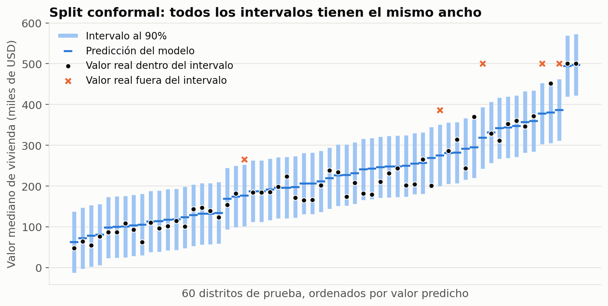

# Conformal Prediction: ejemplo práctico

Experimento reproducible que acompaña una exposición sobre **Conformal Prediction** para el curso de Machine Learning.

Toma un Random Forest que predice el valor de viviendas y convierte sus predicciones puntuales en **intervalos con cobertura garantizada**, implementando *split conformal prediction* a mano. Luego comprueba con datos de prueba que la cobertura pedida se cumple.



## Contenido del repositorio

```
├── conformal_prediction_demo.ipynb   # notebook con todo el experimento
├── data/
│   └── housing.csv                   # dataset California Housing
├── figures/                          # gráficas que genera el notebook
├── requirements.txt                  # versiones fijadas
└── README.md
```

## Cómo reproducirlo

Requiere Python 3.11 o superior.

```bash
git clone <url-del-repositorio>
cd conformal-prediction-demo

python -m venv .venv
source .venv/bin/activate        # en Windows: .venv\Scripts\activate
pip install -r requirements.txt

jupyter notebook conformal_prediction_demo.ipynb
```

En Jupyter: **Run → Run All Cells**. La ejecución completa tarda menos de un minuto.

También se puede ejecutar sin abrir Jupyter:

```bash
jupyter nbconvert --to notebook --execute --inplace conformal_prediction_demo.ipynb
```

## Qué hace el notebook

1. Carga los datos y los divide en entrenamiento (60%), calibración (20%) y prueba (20%).
2. Entrena un `RandomForestRegressor`.
3. Muestra que un intervalo construido con los errores de entrenamiento no cumple lo que promete.
4. Implementa split conformal en tres pasos:
   - puntaje de no conformidad `|y − ŷ|` en calibración,
   - umbral `q̂` en la posición `⌈(n+1)(1−α)⌉` de los puntajes ordenados,
   - intervalo `ŷ ± q̂` para cada dato nuevo.
5. Evalúa la cobertura en prueba para 80%, 90% y 95%, y repite 500 repartos calibración/prueba.
6. Muestra la limitación del ancho constante y la compara con **CQR** (Conformalized Quantile Regression).

## Resultados esperados

Con la semilla (`SEED = 42`) y las versiones de `requirements.txt`, para una cobertura pedida del 90%:

| Método | Cobertura en prueba | Ancho promedio (miles de USD) |
|---|---|---|
| Ingenuo (errores de entrenamiento) | 62.1% | 56.2 |
| Split conformal | 90.1% | 149.7 |
| CQR | 90.4% | 154.9 |

Otros valores de referencia:

- Umbral de split conformal: `q̂ = 74.9` mil USD.
- Cobertura para otros niveles: 79.6% (pedida 80%) y 95.2% (pedida 95%).
- En 500 repartos calibración/prueba: cobertura promedio de 90.0%, entre 87.8% y 91.9%.
- Cobertura por grupo de valor predicho, del 25% más barato al 25% más caro:
  - Split conformal: 98.4%, 95.6%, 88.1%, 78.5%
  - CQR: 91.4%, 91.8%, 90.5%, 87.8%

Con otras versiones de las librerías las cifras pueden cambiar en los decimales; las conclusiones son las mismas.

## Datos

California Housing, censo de 1990 (Pace y Barry, 1997). Cada fila es un distrito censal y la variable objetivo es el valor mediano de las viviendas, topado en 500 mil USD. El archivo `data/housing.csv` es la versión distribuida en el repositorio [ageron/handson-ml2](https://github.com/ageron/handson-ml2). Las 207 filas sin `total_bedrooms` se descartan.

## Referencias

- Vovk, V., Gammerman, A. y Shafer, G. (2005). *Algorithmic Learning in a Random World*. Springer.
- Lei, J., G'Sell, M., Rinaldo, A., Tibshirani, R. J. y Wasserman, L. (2018). Distribution-Free Predictive Inference for Regression. *Journal of the American Statistical Association*.
- Romano, Y., Patterson, E. y Candès, E. (2019). Conformalized Quantile Regression. *NeurIPS*.
- Angelopoulos, A. N. y Bates, S. (2021). [A Gentle Introduction to Conformal Prediction and Distribution-Free Uncertainty Quantification](https://arxiv.org/abs/2107.07511).
- Pace, R. K. y Barry, R. (1997). Sparse Spatial Autoregressions. *Statistics & Probability Letters*.
