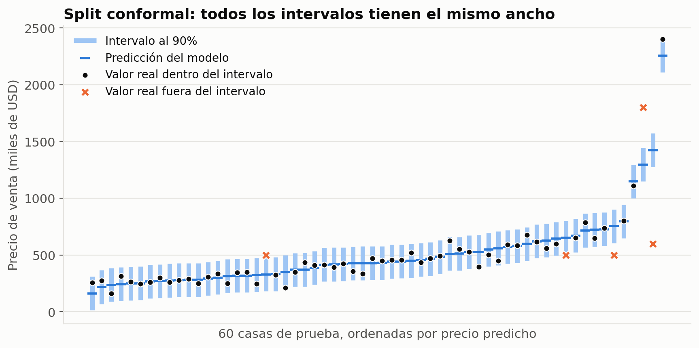
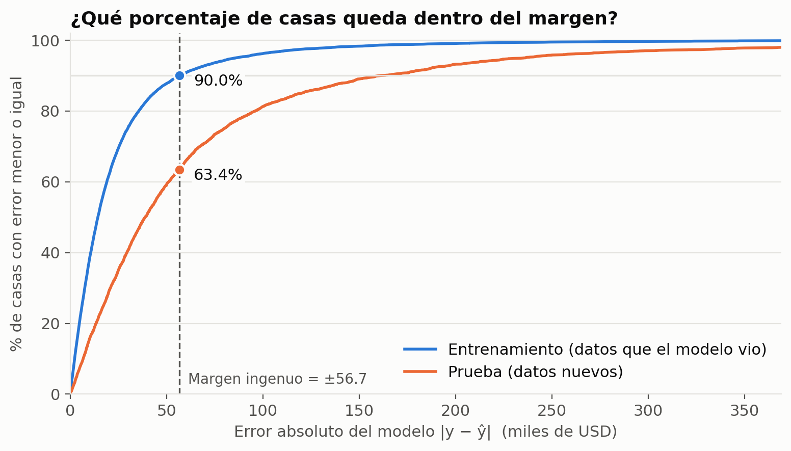
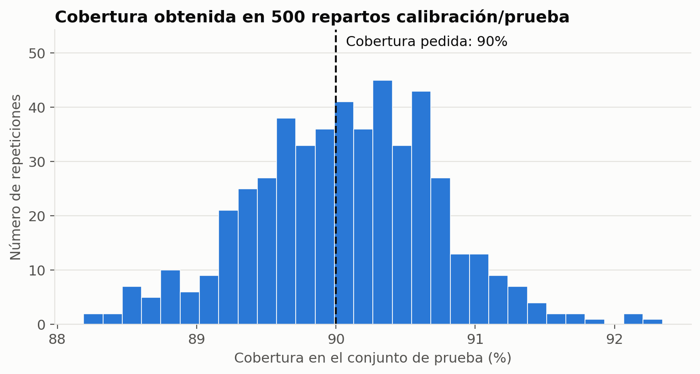
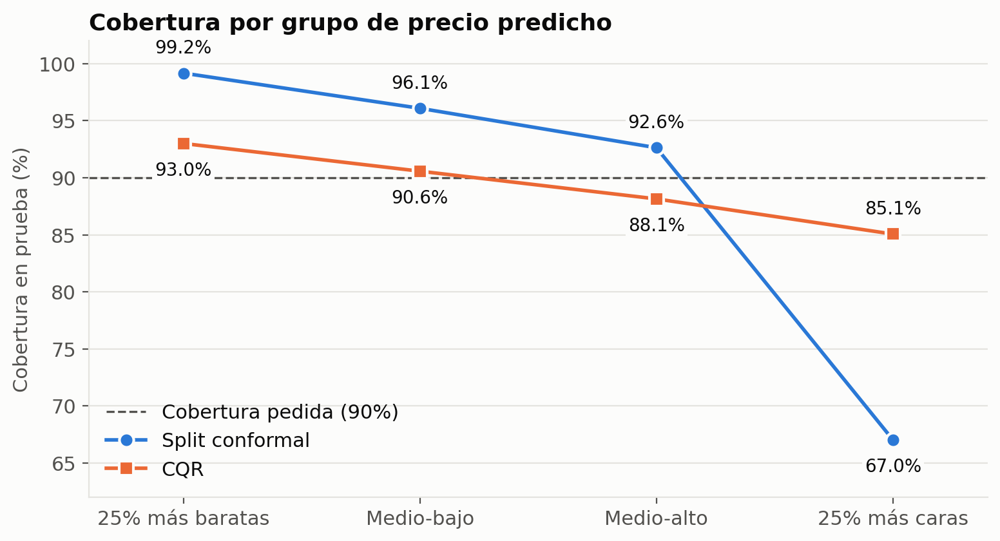

# Conformal Prediction: ejemplo práctico con King County House Sales
## Aprendizaje Automático, Profesor: Juan David Torres
## Integrantes

Exposición del curso de Machine Learning.

- *Samuel Gutierrez*
- *Manuela Castaño*
- *Juan Diego Acuña*

Experimento reproducible que acompaña una exposición sobre **Conformal Prediction** para el curso de Machine Learning.

Un Random Forest predice el precio de venta de casas. Conformal Prediction convierte cada predicción puntual en un **intervalo con cobertura garantizada**: un rango que contiene el precio real el 90% de las veces, sin modificar el modelo. Todo el método (*split conformal prediction*) está implementado a mano para que se vea cada paso, y se comprueba con datos que nunca se usaron para entrenar ni calibrar.



---

## Contenido

1. [El problema](#el-problema)
2. [Datos](#datos)
3. [Metodología](#metodología)
4. [Cómo reproducirlo](#cómo-reproducirlo)
5. [Resultados](#resultados)
6. [Observaciones](#observaciones)
7. [Conclusiones](#conclusiones)
8. [Limitaciones y trabajo futuro](#limitaciones-y-trabajo-futuro)
9. [Referencias](#referencias)

---

## El problema

**En Machine Learning.** Un modelo de regresión entrega un solo número y no dice qué tan confiable es. Si el margen de error se estima con los mismos datos de entrenamiento, el resultado es engañosamente optimista: el modelo ya conoce esas respuestas.

**En este dataset.** Para una casa de 4 habitaciones, 1.75 baños y 1.840 pies², construida en 1958, el Random Forest predice **467.4 mil USD**. Es un buen modelo (R² = 0.866 en datos nuevos), pero en casas que no ha visto se equivoca en promedio por **71.8 mil USD**. ¿En qué rango está realmente el precio?

**Objetivo.** Construir, para cada casa, un intervalo que contenga el precio real el **90%** de las veces, sin cambiar el modelo, y comprobar que esa garantía se cumple.

---

## Datos

**King County House Sales**: ventas reales de casas en el condado de King, Washington (Seattle y alrededores), entre el 2 de mayo de 2014 y el 27 de mayo de 2015. Cada fila es una venta de una casa individual y la variable objetivo es el precio de venta, que se trabaja en miles de USD.

- **Fuente:** publicado en OpenML como `house_sales` (ID 42092) y en Kaggle como `kc_house_data`. El archivo `data/kc_house_data.csv` se tomó del repositorio [Shreyas3108/house-price-prediction](https://github.com/Shreyas3108/house-price-prediction) y coincide con la ficha de OpenML (21.613 ventas).
- **Variables predictoras (17):** habitaciones, baños, área construida, área del lote, pisos, vista al agua, calidad de la vista, estado, calidad de construcción (`grade`), área sobre el suelo, área del sótano, año de construcción, año de renovación, latitud, longitud y áreas promedio de las 15 casas vecinas.
- **Excluidas:** `id` y `date`, que no describen la casa, y `zipcode`, que es un código y no una cantidad (la ubicación ya está en `lat` y `long`).

### Revisión de calidad

| Revisión | Casos |
|---|---|
| Valores faltantes | 0 |
| Filas duplicadas | 0 |
| Casas vendidas más de una vez | 177 |
| Casas con 0 habitaciones | 13 |
| Casas con 0 baños | 10 |
| Casas con 30 o más habitaciones | 1 (33 habitaciones en 1.620 pies²) |
| Ventas por encima de 2 millones de USD | 198 |

### Limpieza

Todas las decisiones se toman antes de dividir los datos, porque ninguna aprende parámetros de ellos.

1. **Una venta por casa.** Se conserva la venta más reciente (se descartan 177). Si la misma casa quedara en entrenamiento y en prueba, el modelo ya la conocería y la evaluación se inflaría.
2. **Se quitan registros imposibles** (17): 0 habitaciones, 0 baños o 33 habitaciones en 1.620 pies².
3. **No se quitan las casas caras.** Son difíciles de predecir, pero reales. Borrarlas mejoraría la cobertura en apariencia, pero la garantía dejaría de describir la realidad.
4. **No se estandariza.** El Random Forest divide por umbrales y no depende de la escala de las variables. Con un modelo sensible a la escala, el escalador debería ajustarse solo con entrenamiento, dentro de un `Pipeline`.

**Resultado:** 21.613 ventas → **21.419 casas**.

---

## Metodología

### Flujo

```
Dataset (21.613 ventas)
   ↓
Revisión y limpieza (21.419 casas)
   ↓
División aleatoria 60 / 20 / 20
   ├── Entrenamiento (12.851) ──→ Entrenar Random Forest
   │                                   ↓
   ├── Calibración (4.284) ─────→ Predecir → errores |y − ŷ| → q̂      ← Conformal Prediction
   │                                                           ↓
   └── Prueba (4.284) ──────────→ Predecir → intervalo ŷ ± q̂ → medir cobertura
```

### Modelo

`RandomForestRegressor` de scikit-learn con 200 árboles y `random_state = 42`, sin ajuste de hiperparámetros. Conformal Prediction lo trata como una caja negra: solo usa sus predicciones.

### Split conformal prediction

Con un nivel de error tolerado α = 0.10 (cobertura objetivo del 90%):

1. **Puntaje de no conformidad** para cada casa de calibración, es decir, cuánto se equivocó el modelo:

   $$s_i = |\,y_i - \hat{y}_i\,|$$

2. **Umbral.** Se ordenan los $n$ puntajes de menor a mayor y se toma el que ocupa la posición $k$:

   $$k = \lceil (n+1)(1-\alpha) \rceil \qquad \hat{q} = s_{(k)}$$

3. **Intervalo** para cualquier casa nueva:

   $$C(x) = [\,\hat{y}(x) - \hat{q},\ \ \hat{y}(x) + \hat{q}\,]$$

**Garantía.** Si las casas de calibración y las nuevas son intercambiables (vienen del mismo proceso), entonces:

$$P\big(y_{\text{nuevo}} \in C(x_{\text{nuevo}})\big) \geq 1 - \alpha$$

La razón: el error de una casa nueva tiene la misma probabilidad de ocupar cualquier posición entre los $n+1$ errores, así que queda entre los $k$ más pequeños con probabilidad $k/(n+1) \geq 1-\alpha$. El "+1" de la fórmula corrige por la casa nueva, y es lo que hace exacta la garantía con muestras finitas.

### Comparaciones incluidas

- **Intento ingenuo:** el mismo cálculo, pero con los errores de entrenamiento en vez de los de calibración. Muestra por qué hace falta un conjunto de calibración.
- **CQR (Conformalized Quantile Regression):** dos modelos `HistGradientBoostingRegressor` predicen los cuantiles 5% y 95%, y Conformal Prediction los calibra con el puntaje $s_i = \max(\hat{q}_{inf}(x_i) - y_i,\ y_i - \hat{q}_{sup}(x_i))$. El intervalo resultante es $[\hat{q}_{inf}(x) - \hat{q},\ \hat{q}_{sup}(x) + \hat{q}]$, con un ancho distinto para cada casa.

### Herramientas

| Librería | Uso |
|---|---|
| scikit-learn | `train_test_split`, `RandomForestRegressor`, `HistGradientBoostingRegressor`, `mean_absolute_error`, `r2_score` |
| NumPy | Todo el procedimiento de Conformal Prediction: puntajes, ordenamiento, umbral, intervalos y cobertura |
| pandas | Carga, revisión y limpieza de datos; tablas de resultados |
| matplotlib | Gráficas |

scikit-learn no incluye Conformal Prediction. La implementación a mano muestra que el método cabe en unas pocas líneas. En un proyecto real puede usarse una librería como [MAPIE](https://github.com/scikit-learn-contrib/MAPIE).

---

## Cómo reproducirlo

Requiere Python 3.11 o superior.

```bash
git clone <url-del-repositorio>
cd <carpeta-del-repositorio>

python -m venv .venv
source .venv/bin/activate        # en Windows: .venv\Scripts\activate
pip install -r requirements.txt

jupyter notebook 02_king_county.ipynb
```

En Jupyter: **Run → Run All Cells**. La ejecución completa tarda alrededor de un minuto.

Sin abrir Jupyter:

```bash
jupyter nbconvert --to notebook --execute --inplace 02_king_county.ipynb
```

### Estructura del repositorio

```
├── 02_king_county.ipynb           # notebook con todo el experimento
├── data/
│   └── kc_house_data.csv          # King County House Sales
├── figures/
│   └── king_county/               # gráficas que genera el notebook
├── requirements.txt               # versiones de las librerías
└── README.md
```

### Secciones del notebook

| Sección | Contenido |
|---|---|
| 1. Problema y datos | Carga, revisión de calidad, limpieza y variables |
| 2. División de los datos | Entrenamiento, calibración y prueba (60/20/20) |
| 3. El modelo | Random Forest, error en cada conjunto y una casa de ejemplo |
| 4. El intento ingenuo | Margen con errores de entrenamiento y por qué falla |
| 5. Split conformal | Las tres ecuaciones, el ranking de errores, el efecto del "+1" |
| 6. Resultado | Intervalos para todas las casas de prueba, conteo y análisis de fallos |
| 7. ¿Se cumple la garantía? | Cobertura al 80/90/95% y 500 repeticiones |
| 8. Limitación | Cobertura por grupo de precio |
| 9. CQR | Intervalos adaptativos y comparación por grupo |
| 10. Resumen | Comparación final de los tres métodos |

---

## Resultados

Cifras obtenidas con `SEED = 42` y las versiones de `requirements.txt`. Con otras versiones de las librerías pueden cambiar en los decimales; las conclusiones son las mismas.

### Desempeño del modelo

| Conjunto | ¿El modelo lo vio? | Error absoluto medio | R² |
|---|---|---|---|
| Entrenamiento | Sí | 25.7 mil USD | 0.983 |
| Calibración | No | 68.9 mil USD | 0.874 |
| Prueba | No | 71.8 mil USD | 0.866 |

### Intento ingenuo frente a calibración

| Conjunto | Error mediano | Percentil 90 del error | Dentro de ±56.7 (margen ingenuo) |
|---|---|---|---|
| Entrenamiento | 14.4 | 56.7 | 90.0% |
| Calibración | 39.2 | 147.6 | 62.8% |
| Prueba | 38.9 | 160.9 | 63.4% |



### Split conformal

- **Umbral:** posición 3.857 de 4.284 → **q̂ = 147.9 mil USD**. Todo intervalo es predicción ± 147.9 (ancho 295.8).
- **Casa de ejemplo:** predicción 467.4 → intervalo [319.5, 615.3] mil USD. El precio real fue 404.0 mil USD: **dentro del intervalo**.
- **Cobertura en prueba:** 3.801 de 4.284 casas → **88.7%**.

| Cobertura pedida | q̂ (miles USD) | Ancho del intervalo | Cobertura obtenida |
|---|---|---|---|
| 80% | 95.2 | 190.3 | 79.8% |
| 90% | 147.9 | 295.8 | 88.7% |
| 95% | 218.7 | 437.4 | 94.2% |

**500 repartos aleatorios entre calibración y prueba** (con el modelo fijo): cobertura promedio de **90.1%**, entre 88.2% y 92.3%.



### ¿Qué casas quedan fuera?

- Predicción mediana de todas las casas de prueba: 459.0 mil USD. De las que quedan fuera: **855.6 mil USD**.
- El **73%** de los fallos está en el 25% de casas más caras. Si los fallos fueran al azar, sería el 25%.

### Cobertura por grupo de precio predicho

| Grupo | Error medio | Split conformal | CQR |
|---|---|---|---|
| 25% más baratas | 33.2 | 99.2% | 93.0% |
| Medio-bajo | 43.7 | 96.1% | 90.6% |
| Medio-alto | 61.5 | 92.6% | 88.1% |
| 25% más caras | 149.0 | **67.0%** | **85.1%** |



### CQR

- Los modelos de cuantiles solos, sin calibrar, cubren el **84.0%**.
- La corrección conformal amplía el rango **+16.1 mil USD** a cada lado.
- Cobertura de CQR: **89.2%**, con intervalos de 60 a 3.714 mil USD de ancho (promedio 306).

### Resumen

| Método | Cobertura (pedida: 90%) | Ancho promedio (miles USD) | Ancho variable |
|---|---|---|---|
| Ingenuo (errores de entrenamiento) | 63.4% | 113.4 | No |
| Split conformal | 88.7% | 295.8 | No |
| CQR | 89.2% | 306.1 | Sí |

---

## Observaciones

1. **El error en entrenamiento engaña.** El modelo se equivoca casi tres veces menos en entrenamiento (error mediano de 14.4) que en casas nuevas (38.9). Un margen calculado ahí promete 90% y cubre 63.4%: acierta en 6 de cada 10 casas en lugar de 9.
2. **Calibración se parece a los datos nuevos.** Calibración y prueba tienen errores casi iguales (mediana 39.2 frente a 38.9), porque ninguno de los dos conjuntos se usó para entrenar. Por eso el umbral calculado en calibración funciona en prueba.
3. **La partición concreta varía; el promedio cumple.** Con la semilla fija la cobertura fue 88.7%, un poco por debajo de lo pedido. En 500 repartos el promedio es 90.1%. La garantía es sobre el promedio de los repartos posibles, no sobre uno en particular.
4. **Más confianza cuesta intervalos más anchos.** Subir de 80% a 95% de cobertura más que duplica el ancho del intervalo (190 → 437 mil USD).
5. **La garantía es marginal, no por grupo.** Con el mismo margen para todas las casas, las baratas quedan cubiertas de sobra (99.2%) y las caras no (67.0%). El 73% de los fallos se concentra en el 25% más caro.
6. **Los precios no topados acentúan el problema.** El dataset incluye ventas de hasta 7,7 millones de USD, y en esas casas los errores del modelo son mucho mayores. Un intervalo de ancho fijo no puede adaptarse a eso.
7. **CQR reparte mejor el margen.** Con la misma calibración, la cobertura en las casas más caras sube de 67.0% a 85.1% y queda más pareja entre grupos (85–93%). El ancho promedio sube poco (296 → 306): CQR no gana por intervalos más angostos en general, sino por asignar más margen donde hace falta.
8. **Un modelo de cuantiles solo no garantiza nada.** Sin calibrar cubre el 84.0%; la corrección conformal lo lleva a 89.2%.

---

## Conclusiones

- **Conformal Prediction cumple lo que promete.** Con una sola regla (medir errores en datos no vistos y tomar el cuantil con la corrección +1) se obtienen intervalos que contienen el precio real alrededor del 90% de las veces, comprobado en 500 repeticiones.
- **No requiere cambiar el modelo.** El Random Forest se entrenó una vez y no se modificó. El mismo procedimiento sirve para cualquier modelo de regresión.
- **La clave es el conjunto de calibración.** La diferencia entre el intento ingenuo (63.4%) y split conformal (88.7%, 90.1% en promedio) no está en el modelo ni en la fórmula, sino en medir los errores en datos que el modelo no vio.
- **La validez viene del método; la utilidad, del modelo y del puntaje.** Split conformal es válido, pero con el puntaje |y − ŷ| da el mismo ancho a todas las casas. CQR conserva la validez y produce intervalos más informativos.
- **La calidad de los datos es parte de la garantía.** Quitar las ventas repetidas evita que una misma casa aparezca en entrenamiento y en prueba, lo que rompería la intercambiabilidad de la que depende el método.

---

## Limitaciones y trabajo futuro

**Limitaciones**

- **Intercambiabilidad.** La garantía supone que las casas nuevas vienen del mismo proceso que las de calibración. Con datos de otra ciudad, de otra época (por ejemplo, de 2024) o con un cambio fuerte del mercado, la garantía deja de aplicar.
- **Cobertura marginal.** Se cumple en promedio, no para cada casa ni para cada subgrupo. CQR mejora la situación, pero el grupo más caro sigue por debajo del 90%.
- **Costo en datos.** El 20% de los datos se reserva para calibrar y no se usa para entrenar.
- **Dependencia temporal.** Las ventas cubren un año y la división es aleatoria, no cronológica. En un uso real, donde se predicen ventas futuras con datos pasados, convendría calibrar con las ventas más recientes.

**Trabajo futuro**

- Probar Conformal Prediction **por grupo** (*Mondrian conformal*) para garantizar cobertura dentro de cada rango de precio.
- Modelar el **logaritmo del precio** para obtener intervalos multiplicativos (±X%) en lugar de aditivos.
- Usar **jackknife+ o CV+** para aprovechar todos los datos en el entrenamiento.
- Hacer una **división temporal** (entrenar con ventas antiguas, calibrar y probar con las recientes) para ver qué tan bien se sostiene la garantía en el tiempo.
- Comparar la implementación a mano con **MAPIE**.

